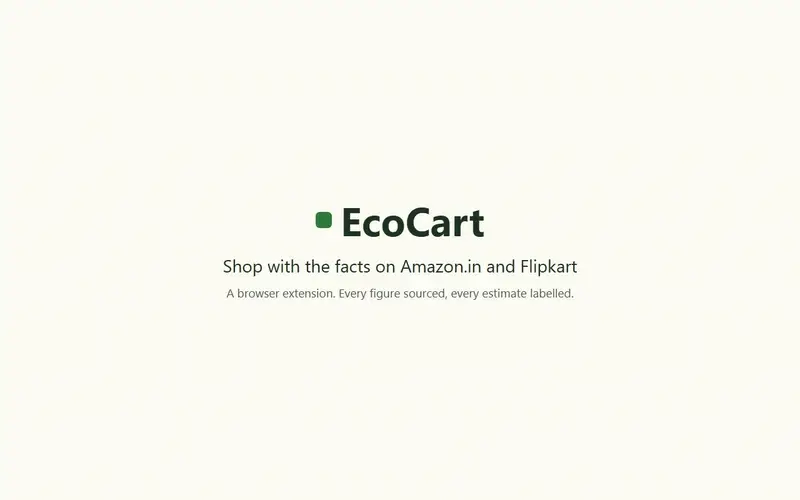
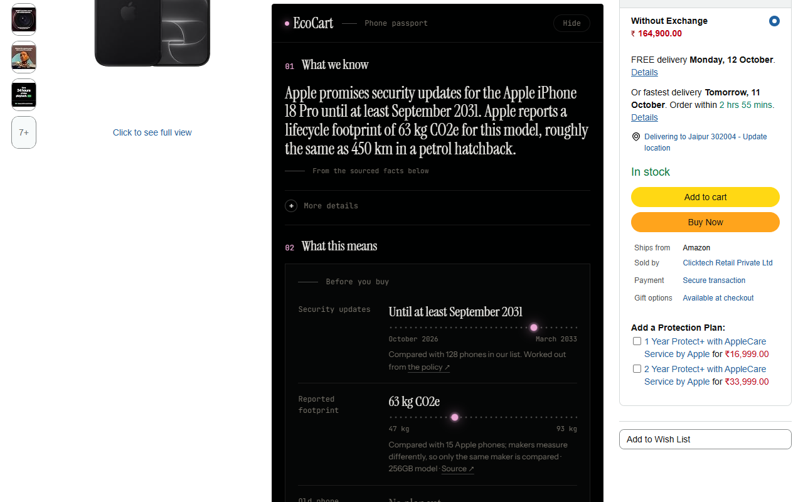
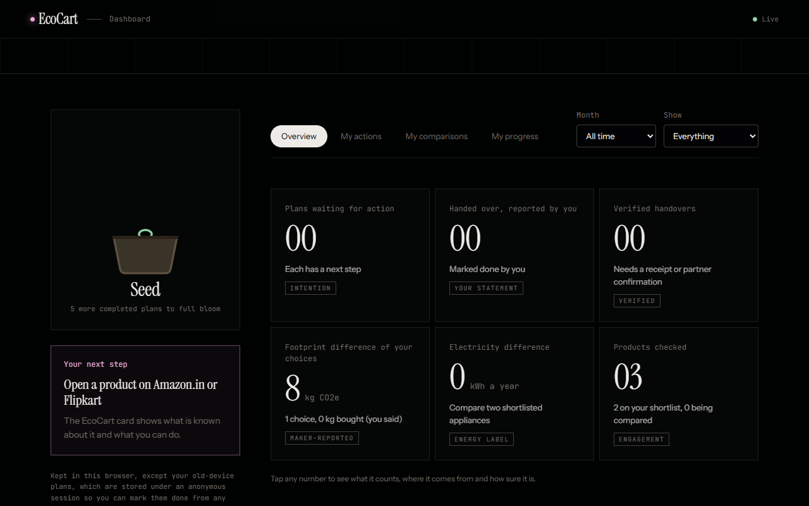
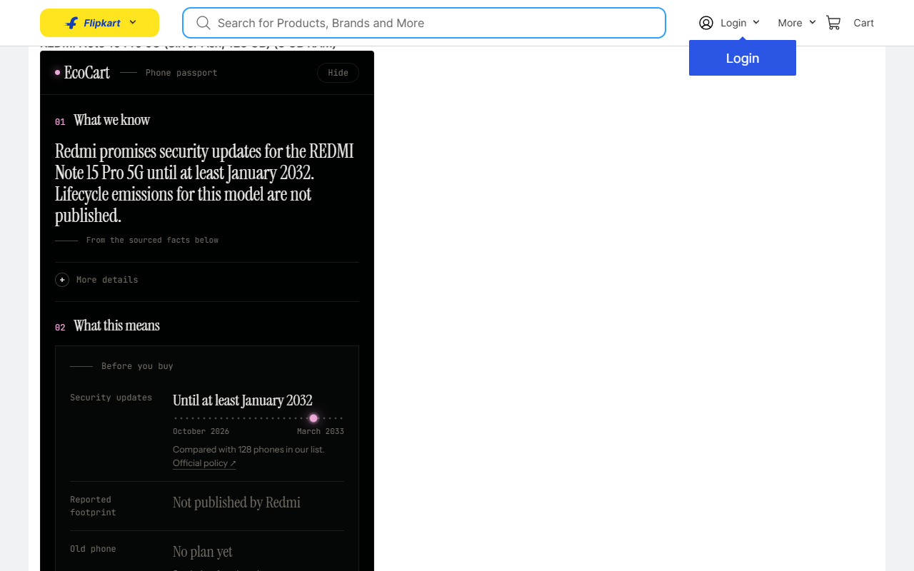
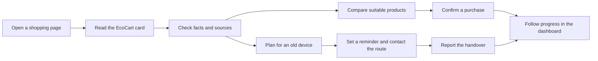
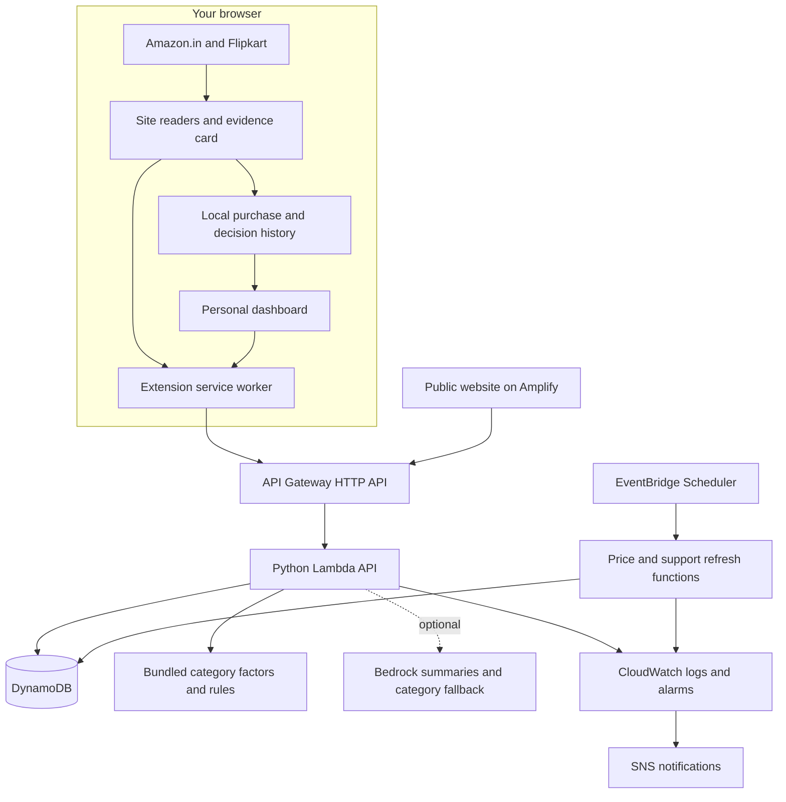
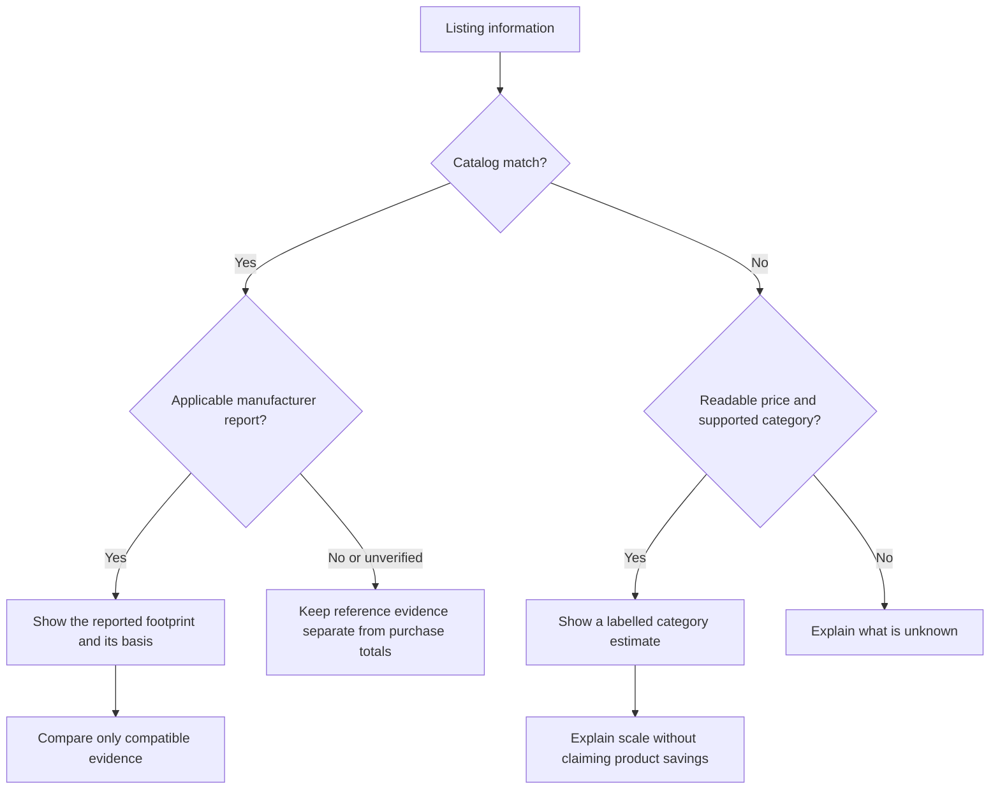

# EcoCart

EcoCart helps people shopping on Amazon.in and Flipkart understand product evidence, compare suitable alternatives and decide what happens to an old device. Its browser extension puts the next useful action beside the listing, with a personal dashboard to follow decisions and handovers.

[](docs/demo/ecocart-demo.mp4)

*An 86-second demo recorded with the real extension on live Amazon.in and Flipkart pages. [Watch the full-quality video](docs/demo/ecocart-demo.mp4).*

[Try EcoCart](https://main.d3ogmfe7tt7uwb.amplifyapp.com/) · [Download the extension](https://main.d3ogmfe7tt7uwb.amplifyapp.com/ecocart-extension.zip) · [Evidence method](docs/method.md) · [Latest verification](docs/verification-2026-10-11.md)

## 1. The problem

A shopper can compare price and specifications easily. Environmental information is harder to find, reports use different methods, and the old device often becomes an afterthought.

EcoCart brings published facts into the shopping page and helps people take a practical next step: compare supported phones, check an appliance's running cost, or find an exchange, resale or recycling route.

## 2. See it working

Open the [live website](https://main.d3ogmfe7tt7uwb.amplifyapp.com/) to try sample listings against the deployed API without installing anything. The website's interactive walkthrough uses sample dashboard data; your extension dashboard uses your own records.



<details>
<summary>Dashboard and Flipkart screenshots</summary>





Screenshots show earlier builds. Evidence wording can change as sources and comparison rules are updated.

</details>

## 3. Features and use cases

| What you want to do | How EcoCart helps |
| --- | --- |
| Understand a phone before replacing yours | Published update support, manufacturer reports and source links |
| Check another device | A longer-supported or lower-footprint alternative when the evidence and price rules allow it |
| Compare appliances | Annual electricity use for the same appliance type and similar capacity, with running cost at your electricity rate |
| Decide what happens to an old device | Exchange, resale and recycling routes, ordered by your device's condition and your goal |
| Follow through | Saved plans, preparation guidance, calendar reminders and reported or verified handover states |
| Track purchases and decisions | Linked purchase confirmations, separate footprint methods and comparison history |
| Understand other products | Labelled category estimates and certification claims stated on the listing |
| Browse search results | Device evidence badges and labelled category estimates beside results |

Routes cover Bengaluru, Chennai, Delhi NCR, Hyderabad, Kolkata, Mumbai and Pune. A route is a contact link, not a booking or a guarantee of service at your address.

## 4. The shopper journey



The card starts with **What to know**, **Worth checking** and **What you can do**. Detailed charts, sources and methods sit behind **See the evidence**.

## 5. Architecture



DynamoDB stores products, routes, conversion factors, anonymous sessions, plans and aggregate counters. Purchases, shortlist, choices and reminders stay in the browser. AWS SAM defines the backend infrastructure.

The current deployment uses deterministic classification rules and template explanations. Bedrock is optional and is not needed for the main workflow.

## 6. Evidence and impact rules



- A manufacturer footprint and a spend-based category estimate have different boundaries. The dashboard keeps them separate.
- Storage-specific reports must match the listing's storage. Reports for an unverified region remain reference evidence and do not enter that listing's footprint total.
- Device choices use one manufacturer and compatible report bases. Dashboard footprint charts use the same report basis.
- Appliance comparisons need stated yearly kWh, the same appliance type and capacities within 10%.
- Alternative device prices must be checked within seven days and fall within 20% of the listing price.
- Category estimates use **listing price × the category's India emissions factor**. They describe a category, not the exact product, and are not used to calculate product-choice savings.
- Reported purchases and handovers are self-reported. Verification requires a receipt or collector confirmation reviewed by the team.
- Car, electricity and tree equivalents explain scale. They do not represent offsets or trees planted by EcoCart.

See [the evidence method](docs/method.md) and [dashboard counting rules](docs/impact.md).

## 7. Evaluation and coverage

The live catalog contains about **170 devices**. The curated file contains **50 models**, including **42 manufacturer carbon reports**. There are **63 city-route records across seven cities**, with some providers appearing in several cities. Counts can change after a data refresh.

Automated checks cover matching, excluded accessories, source requirements, comparison rules, category classification, local history and session isolation. Live browser tests exercise a complete shopper journey on both stores.

These checks do not establish universal product coverage or measured environmental benefit. Outside-user testing and confirmed handover evidence are separate from software tests. The [coverage plan](docs/live-coverage.md) and [user-test protocol](docs/user-test.md) describe how to assess them.

## 8. Testing

Release 0.9.10 passed **109 backend tests, 52 extension tests and 19 research-tooling tests**, plus **360 live API checks**. The browser journey passed on Amazon.in and Flipkart, including purchase undo, monthly filtering, pagination and invalid-backup rejection. A separate live test confirmed that five concurrent saves produce one plan.

From the repository root, with Python dependencies installed:

```powershell
python -m pytest backend/tests -q
node --test extension/tests/*.test.js
python scripts/validate_data.py
```

Research tooling has a separate environment:

```powershell
python -m venv agents/.venv
agents/.venv/Scripts/python -m pip install -r agents/requirements.txt
agents/.venv/Scripts/python -m pytest agents/tests -q
```

For live checks, use a test session against your deployed API:

```powershell
python scripts/smoke_test.py https://YOUR_API_HOST
python tests/e2e/api_concurrency.py https://YOUR_API_HOST
cd tests/e2e
npm install
node journey.js
```

The browser test needs Chrome or Edge. Set `BROWSER` to its executable if automatic discovery fails. Both live runners create temporary plans and delete them on successful completion; inspect and remove leftover test records after an interrupted run.

Validate infrastructure with `sam validate --lint` from `backend/`. See the [verification log](docs/verification-2026-10-11.md) for recorded results and release checks.

## 9. Monitoring and maintenance

| Signal or task | Where to inspect it |
| --- | --- |
| API errors and request failures | Lambda logs and the API error alarm in CloudWatch |
| Daily price refresh | Scheduled Lambda logs and price refresh alarm |
| Weekly support-list refresh | Scheduled Lambda logs and support-list alarm |
| Unmatched categories | `python scripts/list_gaps.py` |
| Shopper reports | `python scripts/list_gaps.py --reports` |
| Pending handover verification | `python scripts/verify_handover.py --pending` |
| Public engagement totals | `GET /stats` and the website |

Prices refresh daily at 09:00 IST. Xiaomi and realme support lists refresh weekly on Sunday at 03:00 IST; OnePlus entries use a saved source copy. An SNS topic must be configured to receive alarm notifications.

Public counters are engagement indicators, not kilograms saved. Plan writes use conditional checks to avoid duplicate requests and conflicting edits. Counter updates are best effort and should be reconciled if a write fails.

## 10. Quickstart

Requirements: Python 3.12+, Node.js 20+, Chrome or Edge. The local API does not require an AWS account.

```powershell
git clone https://github.com/RajdeepKushwaha5/EcoCart.git
cd EcoCart
python -m venv .venv
.venv/Scripts/python -m pip install boto3 pytest
.venv/Scripts/python scripts/validate_data.py
.venv/Scripts/python scripts/local_server.py
```

The API listens at `http://localhost:3000`. For local extension development, set `API_BASE_URL` in `extension/config.js` to that address and add `http://localhost:3000/*` to `host_permissions` in `extension/manifest.json`.

Open `chrome://extensions` or `edge://extensions`, enable Developer mode, choose **Load unpacked**, then select `extension/`. Visit an Amazon.in or Flipkart product page. Local sessions and plans disappear when the server stops. Restore the deployed API address and permission before packaging a release.

To use the hosted build, [download and unzip the extension](https://main.d3ogmfe7tt7uwb.amplifyapp.com/ecocart-extension.zip), then load the extracted `ecocart-extension` folder in the same way.

## 11. Configuration and privacy

| Setting | Location | Purpose |
| --- | --- | --- |
| `API_BASE_URL` | `extension/config.js` | API address |
| `host_permissions` | `extension/manifest.json` | Allowed shop and API hosts |
| `BedrockModelId` | SAM parameter | Optional model or inference profile |
| `SiteOrigin` | SAM parameter | Public website allowed by API CORS |
| `AlertTopicArn` | SAM parameter | Alarm notification topic |
| AWS profile and region | AWS CLI and `backend/samconfig.toml` | Deployment credentials and target |

No account is required. A random bearer token links the browser to saved plans; the server stores its hash. Shopping-page titles, listing details, categories and prices are sent when needed for the card. Search estimates send result titles and prices in batches. Order-page contents are never read.

Backups include the session token, so keep them private. Restore validates supported formats before replacing stored records. Read the [privacy policy](site/privacy.html) for details.

## 12. Deploy on AWS

Install AWS CLI and AWS SAM CLI, then configure an AWS profile with deployment permissions. From the repository root:

```powershell
cd backend
sam build
sam deploy --guided
cd ..
python scripts/seed.py --stack-name ecocart-india --region ap-south-1
```

SAM prints `ApiUrl`. Update the extension configuration and exact API host permission. Set your AWS profile for the scripts, then publish the site and package the extension:

```powershell
$env:AWS_PROFILE = "ecocart"
python scripts/deploy_site.py --stack-name ecocart-india --region ap-south-1
python scripts/package_extension.py
python scripts/smoke_test.py https://YOUR_API_HOST
```

The site deployment includes the current extension download. The store package is written to `dist/ecocart-<version>.zip`. After an extension update, users of an unpacked build must reload it and refresh open shop tabs.

Use the generated category factors already in the repository. To rebuild them from Open CEDA, install `openpyxl` and run `python scripts/build_estimates.py`; this downloads the source workbook. Review changes before deploying new factors.

## 13. API reference

| Method | Path | Purpose |
| --- | --- | --- |
| POST | `/match` | Match a listing to catalog aliases or model numbers |
| POST | `/estimate` | A category estimate or a reason why none is available |
| POST | `/estimates` | Up to 60 title/price estimates using rules only |
| GET | `/products/{modelId}?price=` | Manufacturer evidence, comparisons and explanation |
| GET | `/catalog` | Catalog identities and search badge text |
| GET | `/factors` | Sourced everyday conversion factors |
| GET | `/options?city=&brand=&category=` | Routes filtered by device and city |
| GET | `/stats` | Aggregate plans and catalog coverage |
| POST | `/sessions` | Create an anonymous session |
| POST / GET | `/actions` | Save or list this session's plans |
| PATCH / DELETE | `/actions/{actionId}` | Change or delete an owned plan |
| POST | `/actions/{actionId}/verification` | Request review of handover evidence |
| POST | `/reports` | Report a problem by kind, shop and public listing ID |

Plan endpoints require `Authorization: Bearer <token>`. Save requests support `requestId` for retries. Conflicting plan edits return HTTP 409; refresh before retrying. See `backend/src/app.py` for payload validation and routes.

## 14. Repository map

```text
extension/          Browser extension, popup, dashboard and unit tests
backend/src/        Lambda handlers, evidence rules and bundled factors
backend/tests/      API and domain regression tests
backend/template.yaml
                    SAM infrastructure
site/               Public website, interactive demo and privacy policy
data/               Curated products, routes, factors and category rules
scripts/            Validation, deployment, refresh and verification tools
agents/             Research tooling that produces drafts for human review
tests/e2e/          Real browser shopper-journey tests
docs/               Method, impact rules, coverage and submission records
```

Research drafts do not become published facts automatically. Approval scripts validate and merge reviewed data; source links and checked dates remain required.

## 15. Limitations and next steps

- Retailer layouts change. Passing a sample of live pages does not prove support for every product or variant.
- A price-based category estimate cannot establish that a cheaper item is physically greener. Delivery and packaging are not separately measured.
- Route details come from provider pages. EcoCart does not book collection or independently guarantee recycling outcomes.
- Purchase tracking relies on confirmation, with one record per item per day. Quantity, partial returns and multiple same-day purchases need fuller handling.
- Personal history is local to the browser, with backup rather than account sync. The most recent 500 purchases are retained.
- No controlled study or measured avoided emissions claim is made. Next priorities are broader coverage tests, outside-user results and receipt-backed handovers.

## 16. License and data sources

Application code is under the [MIT License](LICENSE).

Category factors derive from [Open CEDA 2025, CEDA by Watershed](https://registry.opendata.aws/open-ceda/), under CC BY-SA 4.0. The derived factors in `backend/src/estimates.json` retain that licence. Manufacturer reports and provider pages are linked alongside the facts that use them.

Instrument Sans, Instrument Serif and JetBrains Mono use the SIL Open Font License; see [font licence](extension/fonts/OFL.txt). Project provenance and submission details are kept in [submission documentation](docs/submission.md).
